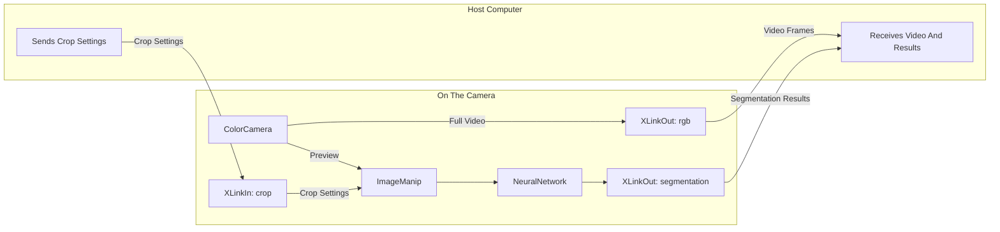

Ught oh, I have a meeting next week and I don't have a webcam for my primary PC; let me use my old Opal C1! Come to find out that Opal is making new hardware and had stopped updating their webcam software and never ported it to any system other than macOS. Up against the wall of not wanting to buy a new camera off Amazon, I decided to reverse engineer the Opal C1 boot chain and replicate it on Windows and Ubuntu so the camera could truly be cross-platform. This is that journey!

## The Camera

The Opal C1 was released as a "DSLR-quality" webcam packaged specifically for macOS users looking for complete control over their webcam. The actual sensor is a `Sony IMX582` or `Sony IMX378`, depending on the unit. Under the hood, the camera was anything but just a lens, containing quite a bit of compute for the various features it supported (face tracking/gesture detection).

The C1 is built around an [Intel Movidius Myriad X](https://www.intel.com/content/www/us/en/products/sku/125926/intel-movidius-myriad-x-vision-processing-unit-4gb/specifications.html). This is a pretty serious chip: it supports vision processing with an image signal processor (ISP), hardware for resizing/cropping images, and 16 vector cores for running neural networks. Opal made use of a lot of features of this chipset...

A separate company called Luxonis builds their OAK cameras with the same chip, and they publish their software stack under the name `depthai`. The Opal C1 also uses a modified version of this software stack under the hood for its primary operation. `depthai` is open source which luckily means that most of the protocol can be read straight from the source.

`depthai` has three parts:

- `Device Firmware`: The program that runs on the Myriad X and executes the pipeline the host sends it.
- `Host Library`: The `depthai-core` that builds the pipeline on the host computer, uploads it, and messages back and forth with the camera.
- `XLink`: The transport between the host and camera over USB.

A `depthai` pipeline is a set of processing blocks called nodes. Each node has connections between them. The main `depthai` nodes used in the C1 are:

- `ColorCamera`: Node that controls the sensor and its ISP on the C1
- `ImageManip`: Node that crops and resizes the image on the C1
- `NeuralNetwork`: Node that runs a neural network on the C1
- `Script`: Node that runs a small Python program on the C1
- `XLinkIn`/`XLinkOut`: Nodes that carry data to and from the C1

A pipeline looks like the following diagram. Each box is a node running on the camera, and each arrow is a queue of messages:



The host never actually reaches into the camera to work on its pixels directly. The host passes over a pipeline at C1 boot then: sends messages into `XLinkIn` nodes and reads messages out of `XLinkOut` nodes. Each `XLinkIn` or `XLinkOut` node becomes a named XLink stream transmitting all kinds of data back and forth between the camera and host.

## USB Time

Diving into how the C1 actually works, plugging it into Linux will cause it to show up as a normal 1080p webcam. Enumerating the device's USB characteristics will show the following:

```bash
$ lsusb
Bus 004 Device 002: ID 03e7:f63d Intel Opal C1
```

The vendor ID (`03e7`) is registered to Intel because Movidius was an Intel acquisition, and `f63d` is the product ID. Depending on the device state, the product ID will change as the developers seem to use it to know the current state of the camera.

Further enumeration will show that there are a few characteristics exposed for the Opal C1:

| Interface | Class | Endpoints | Used For |
| --- | --- | --- | --- |
| 0 | Vendor Specific | Bulk `0x01` Out, `0x81` In | All XLink communication |
| 1 | Video Control | None | UVC controls |
| 2 | Video Streaming | Bulk `0x82` In | Default webcam: NV12 1920x1080 at 60 fps |
| 3 | Audio Control | None | Microphone, 2 channels |
| 4 | Audio Streaming | Isochronous `0x83` In | Microphone audio |

Interfaces 1 and 2 are a standard UVC webcam, which is why the C1 works on any OS with no driver. Interfaces 3 and 4 are a standard USB microphone. Interface 0 isn't standard though, and no OS driver claims it on default Ubuntu. Because these are unclaimed, other userspace software can use the interface 0 bulk endpoints to talk XLink directly with the camera.

## Next Steps

With the camera plugged in and basic functionality understood, the next piece is tying together the host side of the system on macOS. The [Opal Composer](https://op.al/composer) app does the entire process and there is a lot there so lock in for that part.

Part #2 will be understanding the boot flow of the camera and its interactions with the Composer app. Part #3 will cover the port and the functionality transfer.
